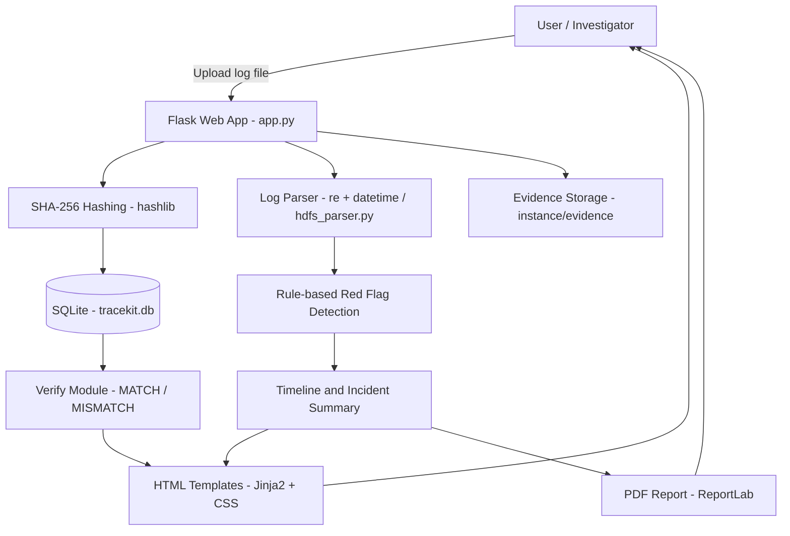

# AIORI-3-HACKATHON-PROJECTS

This repository will contain the code and resources for the AIORI-3 hackathon that will be developed during the AIORI-3.

## Team Introduction Video

[Watch Team Introduction Video on YouTube](https://youtu.be/j5Tt6qvSpoc)

## TraceKit – Live Demo

**Live Application:** https://tracekitdemo-1.onrender.com

**GitHub Source Code:** https://github.com/palak7311/tracekitdemo

---

# TraceKit — Hash Hunters (starter prototype)

A local educational prototype for the AIORI PS-013 idea: evidence upload, SHA-256 fingerprinting, simple log timeline, rule-based red flags, file-copy verification, and PDF export.

## 1. Requirements
- Python 3.10+
- VS Code (recommended)

## 2. Run on Windows
Open this folder in VS Code. In the terminal:

```powershell
py -m venv .venv
.venv\Scripts\activate
python -m pip install -r requirements.txt
python app.py
```

Open the local URL printed in the terminal (normally http://127.0.0.1:5000).

If `py` is not recognized, try `python` instead.

## 3. Demo
1. Upload `sample_logs/demo_incident.log`.
2. Click **Timeline** to see sorted events and simple red flags.
3. Click **Verify** and upload the same file: it should show MATCH.
4. Make a copy of the sample log, change one character, and upload that changed copy in Verify: it should show MISMATCH.
5. Click **PDF** to download a sample report.

## Tech Stack

| Layer | Technology |
|-------|------------|
| Language | Python 3.10+ |
| Backend | Flask |
| Frontend | HTML, CSS, Jinja2 templates |
| Database | SQLite |
| Hashing | `hashlib` (SHA-256) |
| Log parsing | `re`, `datetime` |
| Report export | ReportLab (PDF) |
| Deployment | Render |

## Key Features

- Evidence upload with SHA-256 fingerprinting
- Log timeline with sorted events
- Rule-based red flag detection
- File verification (MATCH / MISMATCH)
- PDF report export
 ## System Architecture


## Screenshots

### Upload Evidence


### Timeline and Red Flags


### Verify: Match


### Verify: Mismatch


### PDF Report


## 4. How it works
- Flask: web server and routes.
- `hashlib.sha256`: computes the file fingerprint.
- SQLite: records filename, uploader, time and hash.
- `re` + `datetime`: parses the demo timestamp format.
- Rule-based checks: marks patterns for human review.
- ReportLab: generates a PDF report.

## Important limitations
- This is a hackathon/demo prototype, not a production forensic evidence platform.
- Use synthetic/demo evidence only. Do not upload real personal, confidential, or third-party evidence without authorization.
- SHA-256 can show whether bytes match a recorded hash. It does not prove who edited a file or when. In a real deployment, protect the hash/custody records independently, keep originals read-only, add access controls and audit logging, and validate parsers against each real log format.
- The attack story is rule-based, not an AI model yet.
- Do not expose Flask's debug server to the public internet.